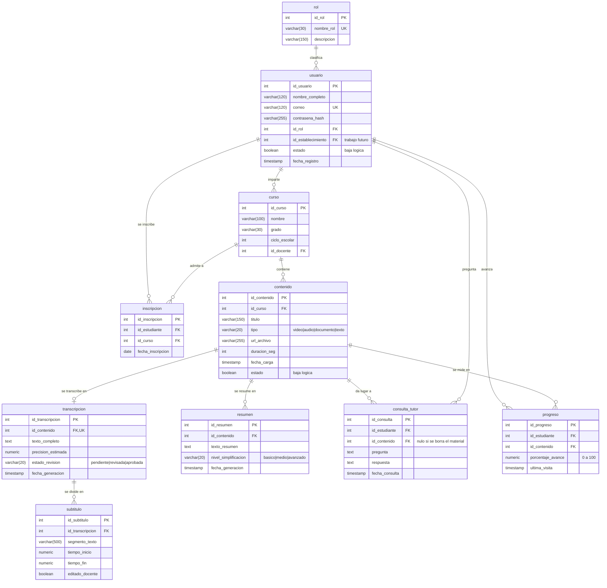
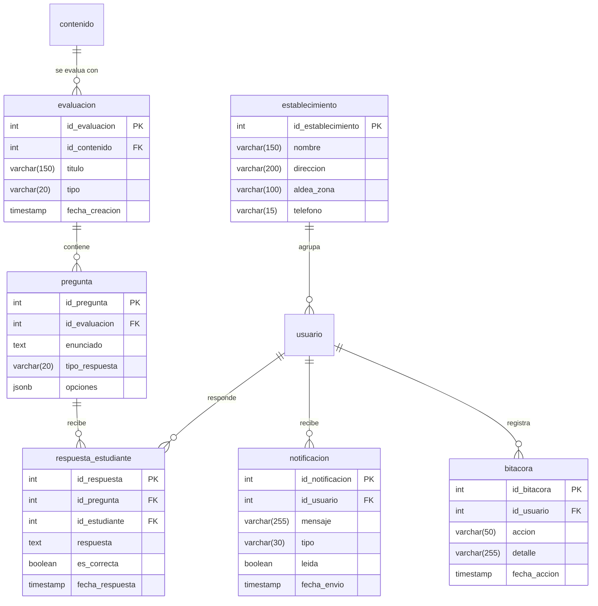

# Modelo de datos

Documento del modelo entidad-relación de **Aula Todos**, la plataforma educativa
con IA para estudiantes con menor capacidad auditiva.

> **Cómo se obtuvo.** El diagrama y las tablas de este documento no se
> transcribieron de los archivos de migración: se extrajeron de la base de
> datos en funcionamiento, consultando `information_schema` y `pg_constraint`.
> Las migraciones dicen lo que se pidió; la base dice lo que hay. Cuando se
> documenta un sistema, lo que vale es lo segundo.

## Qué está implementado y qué no

El modelo tiene **16 tablas**. **Diez** las usa el código; **seis** quedaron
declaradas como trabajo futuro y se documentan aparte, al final.

Esa distinción no es un detalle de redacción. Un diagrama que muestra tablas
sin implementar describe un sistema más grande que el que existe, y en una
defensa eso se convierte en una pregunta que no tiene buena respuesta. Aquí se
separan a propósito.

| Tabla | Referencias en el código | Filas registradas |
|---|---:|---:|
| `contenido` | 22 | 15 |
| `curso` | 19 | 5 |
| `usuario` | 16 | 12 |
| `inscripcion` | 12 | 15 |
| `rol` | 10 | 3 |
| `transcripcion` | 10 | 10 |
| `consulta_tutor` | 6 | 8 |
| `resumen` | 6 | 5 |
| `subtitulo` | 5 | 365 |
| `progreso` | 2 | 1 |
| *(trabajo futuro)* `establecimiento` | 0 | 1 |
| *(trabajo futuro)* `evaluacion` | 0 | 0 |
| *(trabajo futuro)* `pregunta` | 0 | 0 |
| *(trabajo futuro)* `respuesta_estudiante` | 0 | 0 |
| *(trabajo futuro)* `notificacion` | 0 | 0 |
| *(trabajo futuro)* `bitacora` | 0 | 0 |

---

## Diagrama entidad-relación

Solo las diez tablas implementadas.

> Para insertar en el documento de la tesis está exportado como imagen en
> [`er-implementado.png`](er-implementado.png). El diagrama de abajo es la
> fuente: se edita aquí y la imagen se vuelve a generar, de modo que no pueden
> desincronizarse sin que se note.

### Restricciones de unicidad

| Tabla | Columnas | Para qué |
|---|---|---|
| `rol` | `nombre_rol` | No puede haber dos roles con el mismo nombre |
| `usuario` | `correo` | El correo identifica la cuenta |
| `transcripcion` | `id_contenido` | **Una transcripción por material**: dos textos del mismo audio dejarían sin saber cuál leen los subtítulos |
| `inscripcion` | `id_estudiante, id_curso` | No se inscribe dos veces al mismo curso |
| `progreso` | `id_estudiante, id_contenido` | Un solo registro de avance por material y estudiante |

### Reglas de validación en la base

| Tabla | Regla | Por qué está en la base y no solo en el código |
|---|---|---|
| `contenido` | `tipo` ∈ video, audio, documento, texto | Un tipo inventado rompería el reproductor |
| `transcripcion` | `estado_revision` ∈ pendiente, revisada, aprobada | El estudiante ve este valor en pantalla |
| `resumen` | `nivel_simplificacion` ∈ basico, medio, avanzado | Un cuarto nivel reventaría al guardar, **después** de haber pagado la generación |
| `subtitulo` | `tiempo_fin >= tiempo_inicio` | Un subtítulo que termina antes de empezar descuadra el reproductor |
| `progreso` | `porcentaje_avance` entre 0 y 100 | Un 150 % falsearía el panel de seguimiento |

---

## Decisiones de diseño

Las que conviene poder defender.

### Las bajas son lógicas, no borrados

`usuario.estado` y `contenido.estado` marcan la baja en vez de eliminar la fila.

En el caso de `contenido` la razón es concreta: `transcripcion`, `resumen`,
`progreso` y `evaluacion` dependen de él con `ON DELETE CASCADE`. Un borrado
físico se llevaría por delante **el progreso académico de los estudiantes**.
Retirar un material tiene que poder deshacerse; perder lo que alguien ya
estudió, no.

### Una consulta al asistente sobrevive a su material

`consulta_tutor.id_contenido` es `ON DELETE SET NULL`, y además es la única
tabla donde el borrado **sí** es físico: el estudiante puede eliminar cualquier
pregunta suya, y entonces desaparece de verdad.

Si fuera una marca lógica, el docente seguiría viéndola mientras el estudiante
cree que la eliminó. Eso es peor que no ofrecer el borrado.

### El texto de la clase vive en dos sitios, y se mantienen sincronizados

El estudiante lee `subtitulo.segmento_texto`; el asistente lee
`transcripcion.texto_completo`. Son dos copias del mismo contenido, lo cual es
deliberado —cada una se consulta de forma distinta— pero obliga a una regla:
**al corregir un subtítulo se rehace el texto completo** en la misma
transacción.

Sin esa regla, el docente corregía lo que Whisper oyó mal y el asistente seguía
respondiendo con el error, sin que nadie se enterara.

### El avance guarda el punto más lejano, no el último

`progreso.porcentaje_avance` se actualiza con `GREATEST(valor_actual,
valor_nuevo)`. Rebobinar para releer un fragmento, o volver a abrir una clase
terminada, no puede hacer retroceder el avance.

Y el avance del **curso** se promedia sobre *todos* los materiales, contando
como cero los no abiertos. Promediando solo lo visitado, quien abrió una clase
de diez aparecería casi al día.

### Tres niveles de resumen, con diferencia medible

`resumen.nivel_simplificacion` permite varios resúmenes del mismo material.
No son etiquetas decorativas: medido sobre la misma clase, el nivel básico
produjo **6.3 palabras por oración** y el avanzado **11.9**.

Importa porque, para un estudiante sordo señante, el español escrito es una
segunda lengua y es común que se lea por debajo del grado.

---

## Trabajo futuro

Seis tablas quedaron diseñadas pero **sin implementar**. Se conservan en el
esquema porque el diseño es válido y la continuación del proyecto puede
partir de él, pero **no forman parte del sistema entregado**.

> Exportado como imagen en [`er-trabajo-futuro.png`](er-trabajo-futuro.png).

### Por qué quedaron fuera

**El módulo de evaluaciones** (`evaluacion`, `pregunta`,
`respuesta_estudiante`) se descartó por alcance. Son tres tablas y una interfaz
completa de cuestionarios, y no fortalecen el aporte central del trabajo: lo
que distingue a esta plataforma no es evaluar, sino **hacer accesible el
contenido de la clase** a quien no puede oírlo. El asistente educativo ya cubre
el apoyo a la comprensión.

**`establecimiento`** quedó con su clave foránea en `usuario` pero sin gestión.
La plataforma se diseñó para no depender de un establecimiento concreto; dar de
alta y administrar varios centros es la continuación natural, y es poco
trabajo, pero no entró en esta entrega.

**`bitacora`** —registro de auditoría— refuerza el argumento de privacidad del
trabajo, dado que se manejan datos de menores de edad. Se deja planteada por la
misma razón de alcance.

**`notificacion`** es la de menor valor para los objetivos del proyecto: la
plataforma se usa en el aula y el docente avisa en persona.

### Consecuencia para quien continúe

Si alguna de estas tablas no se va a implementar en el futuro, lo correcto es
**eliminarla del esquema** con una migración. Una tabla vacía que nadie
consulta no es una funcionalidad pendiente: es deuda que confunde a quien lea
el modelo después.

---

## Verificación de este documento

El contenido se contrastó contra la base de datos en funcionamiento, no contra
los archivos de migración:

- **16 de 16 tablas** documentadas, con **todos sus campos coincidiendo** con
  `information_schema`.
- Claves foráneas, restricciones de unicidad y reglas `CHECK` leídas de
  `pg_constraint`.
- Los dos diagramas se renderizaron para comprobar que no tienen errores de
  sintaxis antes de darlos por buenos.

Si el esquema cambia, este documento deja de ser cierto. La comprobación es
reproducible: consultar `information_schema.columns` y comparar con los bloques
de entidad del diagrama.
